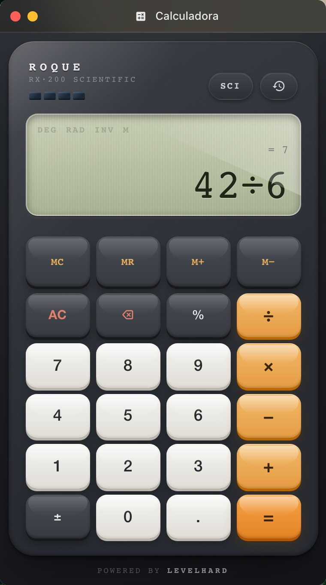

# Calculator

_English | [Português](README.pt-BR.md)_

The scientific calculator of [RoqueOS](https://roqueos.com.br): the four operations with
precedence, powers, roots, factorial, percent, trigonometry in degrees or radians, logarithms,
memory (MC, MR, M+, M−) and history. It looks like a 2000s engineering calculator: a two-line
liquid crystal display (the expression in a dot matrix, the value in seven segments), a brushed
aluminium panel, solar cells and keys that sink when pressed. It accepts the physical keyboard
while its window is active, and its case catches the light as the device tilts (or the pointer
moves), unless the system asks for the light profile. It speaks all ten RoqueOS languages.

Use it for free at [roqueos.com.br](https://roqueos.com.br), on a computer, a phone or a TV.



## Why it is its own repository

The Calculator was born inside RoqueOS, which is closed source. On 27/09/2026 it became the
first app to move to its own repository, open under MIT, in the
[roqueos-apps](https://github.com/roqueos-apps) organization. RoqueOS installs it by tag, as a
git dependency, and it talks to RoqueOS only through the
[`app-sdk`](https://github.com/roqueos-apps/app-sdk). The same code runs inside RoqueOS, alone
in the browser (`yarn dev`) and in the tests, without knowing which of the three it is in.

## Getting started

You need Node 22 or newer (the `.nvmrc` says 24) and Yarn 1.22.

```bash
yarn install --ignore-scripts
yarn dev          # the Calculator in a fake RoqueOS window, with a picker for the ten languages
yarn verificar    # lint, format, tests and app check: the same as CI and the pre-push hook
yarn test         # the tests only
```

In the `yarn dev` window, `?idioma=ar-AR` opens it in Arabic (right to left) and `?leve=1` shows
the app as a low-end device sees it. The full walk-through, with what you should see at each
step, is in [docs/GETTING-STARTED.md](docs/GETTING-STARTED.md).

## What each part is

| Part                                                                     | What it is                                                                                                                   |
| ------------------------------------------------------------------------ | ---------------------------------------------------------------------------------------------------------------------------- |
| [`app.json`](app.json)                                                   | who the app is: the permanent `id` (`calculator`), name and description in ten languages, icon, color, category, window size |
| [`src/index.js`](src/index.js)                                           | `definirApp`: creates the app's own Vue app inside the element RoqueOS hands over                                            |
| [`src/Calculadora.vue`](src/Calculadora.vue)                             | the case, the keypad, the input and the history                                                                              |
| [`src/Visor.vue`](src/Visor.vue) and [`src/visor/`](src/visor/matriz.js) | the two-line display and its geometry, pure functions                                                                        |
| [`src/motor.js`](src/motor.js)                                           | the arithmetic: tokens, reverse Polish notation and evaluation, pure functions                                               |
| [`i18n/`](i18n/pt-BR.json)                                               | the screen texts, one JSON per language                                                                                      |
| [`paridade.json`](paridade.json)                                         | the inventory of what the app did inside RoqueOS and what happened to each item when it moved out                            |
| [`test/`](test/app.spec.js)                                              | Vitest: the screen, the display, both geometries, the app through the SDK, language switching, the engine and the tilt       |

How the parts fit together, with diagrams, is in [docs/ARCHITECTURE.md](docs/ARCHITECTURE.md).

## Status and limits

Version 0.2.0 (28/09/2026) is the one RoqueOS pins today (`roqueos-front/package.json`,
`github:roqueos-apps/calculadora#v0.2.0`). The app stores nothing: history (up to 60 entries)
and memory live only while the window is open. It does not talk to a server or a database, asks
for no optional capability. The calculator itself looks the same in light and dark; only the
desk around it and the footer follow the RoqueOS theme, through the contract's `--ros-text-100`.
There is no copy and paste. Nothing was measured on a real iPhone or Android device; the tilt on those is covered by
tests with a simulated sensor only. The rest of the known limits is in
[docs/ARCHITECTURE.md](docs/ARCHITECTURE.md#9-known-limits).

## Documentation

Start at the index, [docs/INDEX.md](docs/INDEX.md). Each document answers one question:

| I want to...                              | Read                                               |
| ----------------------------------------- | -------------------------------------------------- |
| install it and see it working             | [docs/GETTING-STARTED.md](docs/GETTING-STARTED.md) |
| understand how it is built                | [docs/ARCHITECTURE.md](docs/ARCHITECTURE.md)       |
| look up a command, file or format         | [docs/REFERENCE.md](docs/REFERENCE.md)             |
| release a version and get it into RoqueOS | [docs/OPERATIONS.md](docs/OPERATIONS.md)           |
| fix something that broke                  | [docs/WHEN-IT-BREAKS.md](docs/WHEN-IT-BREAKS.md)   |
| know what a word means here               | [docs/GLOSSARY.md](docs/GLOSSARY.md)               |
| see how RoqueOS and the app talk          | [docs/INTEGRATIONS.md](docs/INTEGRATIONS.md)       |
| know what each test suite proves          | [docs/TESTING.md](docs/TESTING.md)                 |
| know what is decided and not reopened     | [docs/DECISIONS.md](docs/DECISIONS.md)             |

## Contributing

Read [CONTRIBUTING.md](CONTRIBUTING.md). Every commit carries `Signed-off-by` (DCO), and CI
checks it. Security issues go through [SECURITY.md](SECURITY.md), never a public issue.

## Credits and license

[MIT](LICENSE). The history icon is `history` from
[Material Icons](https://fonts.google.com/icons), under Apache-2.0, drawn inline in
`Calculadora.vue` (see [ASSETS.md](ASSETS.md)). The RoqueOS name and brand belong to LEVELHARD
and are not covered by the license.
