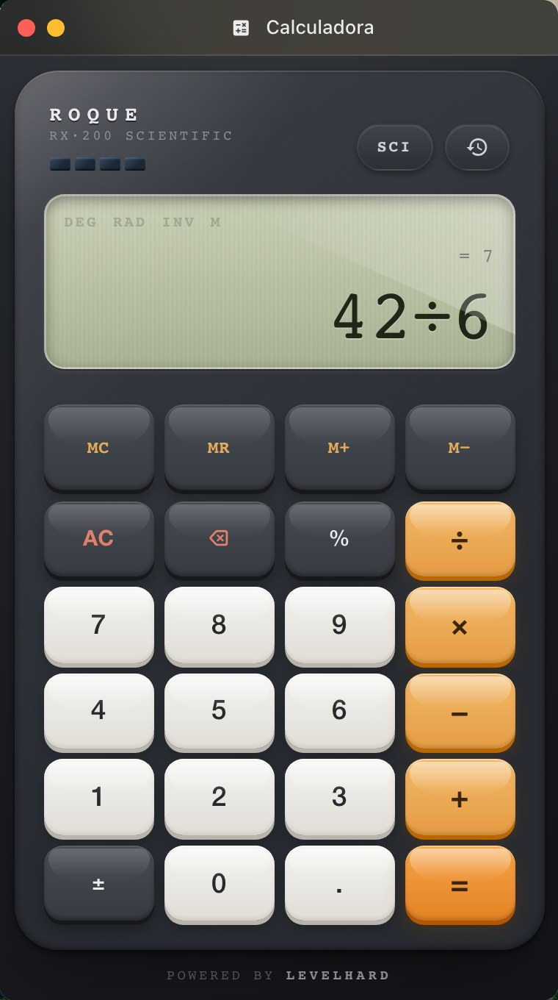

# Calculadora

_[English](README.md) | Português_

A calculadora científica do [RoqueOS](https://roqueos.com.br): quatro operações com
precedência, potência, raiz, fatorial, porcentagem, trigonometria em graus ou radianos,
logaritmos, memória (MC, MR, M+, M−) e histórico. Tem a cara de uma calculadora de engenharia
dos anos 2000: visor de cristal líquido de duas linhas (a conta em matriz de pontos, o valor em
sete segmentos), painel de alumínio escovado, células solares e teclas que afundam. Aceita o
teclado físico quando a janela está ativa, e a carcaça pega a luz conforme o aparelho inclina
(ou o ponteiro passa), a não ser que o sistema peça o perfil leve. Nos dez idiomas do RoqueOS.

Use de graça em [roqueos.com.br](https://roqueos.com.br), no computador, no celular e na TV.



## Por que existe como repo

A Calculadora nasceu dentro do RoqueOS, que é fechado. Em 27/09/2026 ela foi o primeiro app a
sair para o próprio repositório, aberto sob MIT, na organização
[roqueos-apps](https://github.com/roqueos-apps). O RoqueOS a instala por uma tag, como
dependência git, e ela fala com ele só pelo
[`app-sdk`](https://github.com/roqueos-apps/app-sdk). O mesmo código roda dentro do RoqueOS,
sozinho no navegador (`yarn dev`) e no teste, sem saber em qual dos três está.

## Como começar

Você precisa de Node 22 ou mais novo (o `.nvmrc` diz 24) e Yarn 1.22.

```bash
yarn install --ignore-scripts
yarn dev          # a Calculadora numa janela falsa do RoqueOS, com o seletor dos dez idiomas
yarn verificar    # lint, formato, testes e app check: o mesmo do CI e do pre-push
yarn test         # só os testes
```

Na janela do `yarn dev`, `?idioma=ar-AR` abre em árabe (da direita para a esquerda) e
`?leve=1` mostra o app como o aparelho fraco vê. O passo a passo inteiro, com o que você deve
ver em cada passo, está em [docs/pt-BR/COMECAR.md](docs/pt-BR/COMECAR.md).

## O que é cada parte

| Parte                                                                  | O que é                                                                                                                    |
| ---------------------------------------------------------------------- | -------------------------------------------------------------------------------------------------------------------------- |
| [`app.json`](app.json)                                                 | quem o app é: o `id` permanente (`calculator`), nome e descrição nos dez idiomas, ícone, cor, categoria, tamanho da janela |
| [`src/index.js`](src/index.js)                                         | `definirApp`: cria o app Vue próprio dentro do elemento que o RoqueOS entrega                                              |
| [`src/Calculadora.vue`](src/Calculadora.vue)                           | a carcaça, o teclado, a entrada e o histórico                                                                              |
| [`src/Visor.vue`](src/Visor.vue) e [`src/visor/`](src/visor/matriz.js) | o visor de duas linhas e a geometria dele, funções puras                                                                   |
| [`src/motor.js`](src/motor.js)                                         | a conta: fichas, notação polonesa reversa e avaliação, funções puras                                                       |
| [`i18n/`](i18n/pt-BR.json)                                             | os textos da tela, um JSON por idioma                                                                                      |
| [`paridade.json`](paridade.json)                                       | o inventário do que o app fazia dentro do RoqueOS e do que aconteceu com cada item na saída                                |
| [`test/`](test/app.spec.js)                                            | Vitest: a tela, o visor, as duas geometrias, o app pelo SDK, a troca de idioma, o motor e o reflexo                        |

Como as partes se encaixam, com diagramas, está em
[docs/pt-BR/ARQUITETURA.md](docs/pt-BR/ARQUITETURA.md).

## Estado e limites

A versão 0.2.0 (28/09/2026) é a que o RoqueOS pina hoje (`roqueos-front/package.json`,
`github:roqueos-apps/calculadora#v0.2.0`). O app não grava nada: o histórico (até 60 contas) e a
memória só vivem enquanto a janela está aberta. Não fala com servidor nem com banco, não pede
capacidade opcional. A calculadora fica igual no tema claro e no escuro; só a mesa em volta e
o rodapé seguem o tema do RoqueOS, pelo `--ros-text-100` do contrato. Não tem copiar e colar. Nada foi medido num
iPhone nem num Android de verdade; a inclinação neles só está coberta por teste com sensor
simulado. O resto dos limites conhecidos está em
[docs/pt-BR/ARQUITETURA.md](docs/pt-BR/ARQUITETURA.md#9-limites-conhecidos).

## Documentação

Comece pelo índice, [docs/pt-BR/INDEX.md](docs/pt-BR/INDEX.md). Cada documento responde uma
pergunta:

| Quero...                                    | Leia                                                       |
| ------------------------------------------- | ---------------------------------------------------------- |
| instalar e ver funcionando                  | [docs/pt-BR/COMECAR.md](docs/pt-BR/COMECAR.md)             |
| entender como é feito                       | [docs/pt-BR/ARQUITETURA.md](docs/pt-BR/ARQUITETURA.md)     |
| consultar um comando, arquivo ou formato    | [docs/pt-BR/REFERENCIA.md](docs/pt-BR/REFERENCIA.md)       |
| soltar uma versão e levar ao RoqueOS        | [docs/pt-BR/OPERACAO.md](docs/pt-BR/OPERACAO.md)           |
| consertar o que quebrou                     | [docs/pt-BR/QUANDO-QUEBRA.md](docs/pt-BR/QUANDO-QUEBRA.md) |
| saber o que uma palavra quer dizer aqui     | [docs/pt-BR/GLOSSARIO.md](docs/pt-BR/GLOSSARIO.md)         |
| ver como o RoqueOS e o app conversam        | [docs/pt-BR/INTEGRACOES.md](docs/pt-BR/INTEGRACOES.md)     |
| saber o que cada suíte de teste prova       | [docs/pt-BR/TESTES.md](docs/pt-BR/TESTES.md)               |
| saber o que já foi decidido e não se reabre | [docs/pt-BR/DECISOES.md](docs/pt-BR/DECISOES.md)           |

## Contribuir

Leia o [CONTRIBUTING em português](docs/pt-BR/CONTRIBUTING.md) (o original, em inglês, é o
[CONTRIBUTING.md](CONTRIBUTING.md)). Todo commit leva `Signed-off-by` (DCO), e o CI confere.
Falha de segurança vai pelo [SECURITY.md](SECURITY.md), nunca por issue pública.

## Créditos e licença

[MIT](LICENSE). O ícone do histórico é o `history` do
[Material Icons](https://fonts.google.com/icons), sob Apache-2.0, desenhado inline em
`Calculadora.vue` (veja o [ASSETS.md](ASSETS.md)). O nome e a marca RoqueOS são da LEVELHARD e
não fazem parte da licença.
