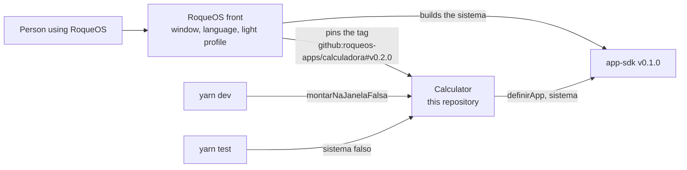
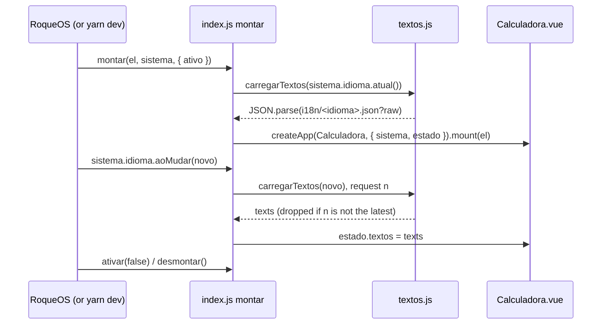
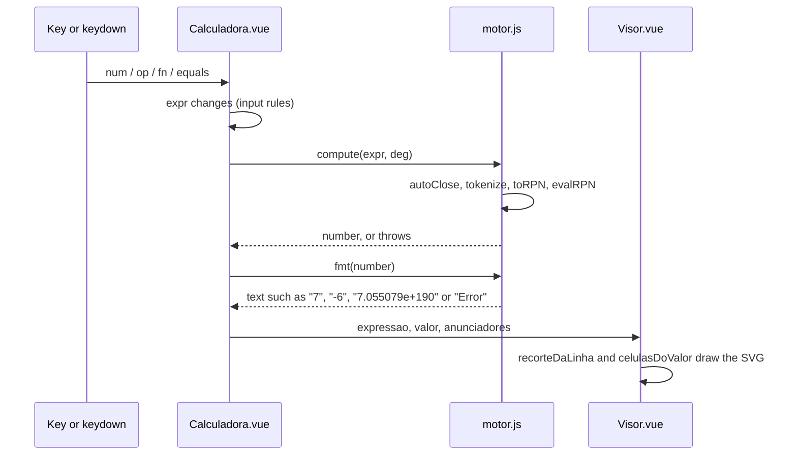

# Architecture

_English | [Português](pt-BR/ARQUITETURA.md)_

> **Who it is for:** whoever is about to change the calculator, or review a change to it.
> **What is here:** the idea, the context, where it runs, the components and their files, the two main flows, the data that crosses a boundary, security, the design decisions and the known limits.
> **Where to go for the rest:** commands and formats field by field in [REFERENCE.md](REFERENCE.md); the contract with RoqueOS in [INTEGRATIONS.md](INTEGRATIONS.md); product decisions in [DECISIONS.md](DECISIONS.md).

## Contents

1. [The idea in one paragraph](#1-the-idea-in-one-paragraph)
2. [Context: who uses it and what it depends on](#2-context-who-uses-it-and-what-it-depends-on)
3. [Processes and where they run](#3-processes-and-where-they-run)
4. [Components](#4-components)
5. [The main flows](#5-the-main-flows)
6. [Data and contracts](#6-data-and-contracts)
7. [Security and secrets](#7-security-and-secrets)
8. [Design decisions](#8-design-decisions)
9. [Known limits](#9-known-limits)
10. [How the diagrams are made](#10-how-the-diagrams-are-made)

## 1. The idea in one paragraph

The Calculator is a RoqueOS app that lives outside RoqueOS. It exports one object built with
`definirApp` from `@roqueos-apps/app-sdk` ([src/index.js](../src/index.js)); RoqueOS calls its
`montar` with an element, the `sistema` and whether the window is active, and the app creates its
own Vue app inside that element. Everything it needs from the system (language, light profile,
active window) comes through `sistema`; it imports nothing from RoqueOS. The arithmetic is a pure
module ([src/motor.js](../src/motor.js)) and the display is SVG drawn from pure geometry
([src/visor/](../src/visor/matriz.js)), so most of the behavior is tested without a screen.

## 2. Context: who uses it and what it depends on

| Dependency                                                                  | What it is for                                                             | What happens when it is missing                                         |
| --------------------------------------------------------------------------- | -------------------------------------------------------------------------- | ----------------------------------------------------------------------- |
| [`@roqueos-apps/app-sdk`](https://github.com/roqueos-apps/app-sdk) `v0.1.0` | `definirApp`, the dev window, the fake system for tests, the `app` command | no install (it comes from GitHub by tag), no `yarn dev`, no `app check` |
| `vue` `^3.5.0` (peer)                                                       | the app's own Vue app                                                      | RoqueOS provides it; in this repo it is a dev dependency (`3.5.29`)     |
| RoqueOS front                                                               | hosts the window and builds the real `sistema`                             | the app keeps working alone in `yarn dev`                               |
| network, server, database                                                   | none                                                                       | nothing: the app never calls out                                        |

## 3. Processes and where they run

| Where                          | How it starts                                                                                                                | Who calls it                                   |
| ------------------------------ | ---------------------------------------------------------------------------------------------------------------------------- | ---------------------------------------------- |
| Inside RoqueOS, in the browser | RoqueOS opens the window with id `calculator` and calls `montar`                                                             | the person, from the dock, Launchpad or search |
| Alone, in the browser          | `yarn dev` (Vite, [vite.config.js](../vite.config.js)) serves [index.html](../index.html) and [dev/main.js](../dev/main.js)  | the developer                                  |
| In Node, under jsdom           | `yarn test` (Vitest, setup in [test/preparar.js](../test/preparar.js))                                                       | the developer, the pre-push hook and CI        |
| GitHub Actions                 | [ci.yml](../.github/workflows/ci.yml) on push to `main` and on every PR; [dco.yml](../.github/workflows/dco.yml) on every PR | GitHub                                         |

Inside RoqueOS the app is compiled by the RoqueOS Vite, not by this repository's
[vite.config.js](../vite.config.js); that file only serves `yarn dev` and `yarn test`.

## 4. Components

| File                                                                                 | Responsibility                                                                                                                          | Who depends on it                                        |
| ------------------------------------------------------------------------------------ | --------------------------------------------------------------------------------------------------------------------------------------- | -------------------------------------------------------- |
| [app.json](../app.json)                                                              | the manifest: permanent `id`, names, descriptions, icon, color, category, window, capabilities                                          | RoqueOS (generated registry), `app check`, `dev/main.js` |
| [src/index.js](../src/index.js)                                                      | `definirApp`: mounts the Vue app after the texts arrive, keeps `estado` (`ativo`, `idioma`, `textos`), returns `ativar` and `desmontar` | RoqueOS, `dev/main.js`, `test/app.spec.js`               |
| [src/Calculadora.vue](../src/Calculadora.vue)                                        | the case, the keypad (`TECLADO`), input rules, memory, history, physical keyboard                                                       | `index.js`                                               |
| [src/Visor.vue](../src/Visor.vue)                                                    | the two-line display: annunciators, dot matrix, seven segments, hidden real text                                                        | `Calculadora.vue`                                        |
| [src/visor/matriz.js](../src/visor/matriz.js)                                        | the 5 × 7 font drawn here, the 16-character line and its cut (`recorteDaLinha`)                                                         | `Visor.vue`                                              |
| [src/visor/segmentos.js](../src/visor/segmentos.js)                                  | the segments of each character, 13 cells plus a 3-digit exponent (`celulasDoValor`)                                                     | `Visor.vue`                                              |
| [src/motor.js](../src/motor.js)                                                      | `tokenize`, `toRPN`, `evalRPN`, `autoClose`, `compute`, `fmt`                                                                           | `Calculadora.vue`                                        |
| [src/textos.js](../src/textos.js)                                                    | static map of the ten `i18n/*.json`, loaded with `?raw`; `traduzir`                                                                     | `index.js`, `Calculadora.vue`                            |
| [src/useInclinacao.js](../src/useInclinacao.js)                                      | the reflection that follows the sensor or the pointer                                                                                   | `Calculadora.vue`                                        |
| [src/calculadora.scss](../src/calculadora.scss), [src/visor.scss](../src/visor.scss) | the case and keys in `cqw` of the case, the liquid crystal; colors in `--calc-*`                                                        | the two components                                       |

## 5. The main flows

**Mounting and switching language.** `montar` asks for the texts of the current language and only
creates the Vue app once they arrive, so the history never shows without its label. Each language
request takes a number; an answer that is not the latest one is dropped, so two switches in a row
end in the last language asked for ([src/index.js](../src/index.js),
[test/troca-de-idioma.spec.js](../test/troca-de-idioma.spec.js)).

**From a key press to the display.** A key on the screen or on the physical keyboard (only while
`estado.ativo`) changes the expression string. While typing, a watcher recomputes a preview; an
expression that does not close yet keeps the last preview that did. `=` evaluates, records the
history entry (newest first, up to 60) and switches to result mode
([src/Calculadora.vue](../src/Calculadora.vue)).

## 6. Data and contracts

Three files cross a boundary; their fields are in [REFERENCE.md](REFERENCE.md#formats) and the
contract in [INTEGRATIONS.md](INTEGRATIONS.md).

| File                                                    | Who writes it   | Who reads it                                                                                  |
| ------------------------------------------------------- | --------------- | --------------------------------------------------------------------------------------------- |
| [app.json](../app.json)                                 | this repository | RoqueOS (`scripts/apps-de-primeira-parte.mjs` in `roqueos-front`), `app check`, `dev/main.js` |
| [i18n/](../i18n/pt-BR.json) (ten files, five keys each) | this repository | `textos.js`, `app check`                                                                      |
| [paridade.json](../paridade.json)                       | this repository | RoqueOS (`scripts/paridade-dos-apps.mjs`, `apps-fora-do-nucleo.spec.js`)                      |

The text the engine writes is also a contract between `motor.js` and the display: `fmt` returns
`"0"`, up to twelve significant digits, exponential notation outside `1e-9 <= |n| < 1e12`, or
`"Error"`, and the display was sized for the longest of those (13 cells).

## 7. Security and secrets

There are no secrets: no key, token, `.env` or account. The app stores nothing, calls no server or
database, and declares no capability (`"capacidades": []` in [app.json](../app.json)). It runs on
the same origin as RoqueOS, which is not a security boundary; what protects people is in
[SECURITY.md](../SECURITY.md): maintainer review through [CODEOWNERS](../.github/CODEOWNERS),
signed-off commits, an exact tag pinned in RoqueOS, no install scripts, and CI that reads no
secret and only has `contents: read`.

## 8. Design decisions

| Decided                                                                                     | Refused alternative                    | Why                                                                                                                                                                                                                | When                                                        |
| ------------------------------------------------------------------------------------------- | -------------------------------------- | ------------------------------------------------------------------------------------------------------------------------------------------------------------------------------------------------------------------ | ----------------------------------------------------------- |
| The app creates its own Vue app inside the element                                          | a component inside the RoqueOS Vue app | the same code runs in RoqueOS, in `yarn dev` and in tests; no RoqueOS store, plugin or global style gets in ([src/index.js](../src/index.js))                                                                      | 27/09/2026 (0.1.0)                                          |
| Texts load as `?raw` and `JSON.parse`, from a static map                                    | `import` of JSON; `import(variable)`   | the RoqueOS build breaks on a direct JSON import outside its `src/i18n/` (measured in the games on 25/09/2026); a variable import makes Vite bundle all ten languages together ([src/textos.js](../src/textos.js)) | 27/09/2026                                                  |
| The engine is a pure module with degrees passed as an argument                              | arithmetic inside the component        | it is tested without mounting the screen ([test/motor.spec.js](../test/motor.spec.js))                                                                                                                             | 27/09/2026                                                  |
| `tokenize` reads the hyphen and `e+` that `fmt` writes                                      | leaving them unreadable                | continuing from `-6` lost the sign and continuing from exponential notation gave Error (fixed 28/09/2026)                                                                                                          | 28/09/2026 (0.2.0)                                          |
| The display is SVG with a font and segments drawn here, fixed at 16 characters and 13 cells | a font file; a display that shrinks    | no asset to license, and nothing shrinks or cuts: 13 cells is the longest `fmt` output                                                                                                                             | 28/09/2026 (0.2.0)                                          |
| The keypad and display are always `dir="ltr"`                                               | following the language direction       | mirroring would put 7 to the right of 9 and turn "M−" into "−M"                                                                                                                                                    | already inside RoqueOS, kept (`mantida` in `paridade.json`) |
| Light profile from `sistema.desempenho.modoLeve()`                                          | the RoqueOS `data-low-end` attribute   | that attribute is a RoqueOS detail nobody pins ([src/useInclinacao.js](../src/useInclinacao.js))                                                                                                                   | 28/09/2026 (0.2.0)                                          |
| Colors are `--calc-*` and none is read from the RoqueOS theme                               | following the theme                    | the calculator is an object and looks the same in light and dark; the `--ros-` prefix belongs to the system                                                                                                        | 28/09/2026 (0.2.0)                                          |
| Sizes in `cqw` of the case                                                                  | pixels                                 | the whole calculator scales as one object and fits the 300 × 540 minimum window                                                                                                                                    | 28/09/2026 (0.2.0)                                          |

Product decisions (the permanent `id`, the 2000s look, what the app does not do) are in
[DECISIONS.md](DECISIONS.md).

## 9. Known limits

- Nothing was measured on a real iPhone or Android device (the `paridade.json` audit says so); the
  tilt is covered by tests with a simulated sensor ([test/useInclinacao.spec.js](../test/useInclinacao.spec.js)).
- History and memory are lost when the window closes; nothing persists.
- No copy and paste: the root has `user-select: none` and there is no clipboard shortcut.
- Numbers are JavaScript doubles: `fmt` shows twelve significant digits, and `n!` above 170 is
  `Infinity`, which the engine reports as `Error`.
- An expression longer than 16 characters shows its end on the top line, with ◀ lit; the start is
  not visible on the display (the hidden text keeps the whole expression).
- `CLAUDE.md` says the app may use six RoqueOS CSS variables from the SDK contract; the code uses
  none (no `var(--ros-` in `src/`, checked on 18/11/2026).
- RoqueOS compiles the app with its own Vite; a build problem there does not show up in this
  repository's `yarn verificar`.

## 10. How the diagrams are made

Mermaid inside this file, rendered by GitHub. The Portuguese pair carries the same diagrams with
translated labels. The cover image [capa.jpg](capa.jpg) is a screenshot, documented in
[ASSETS.md](../ASSETS.md).
