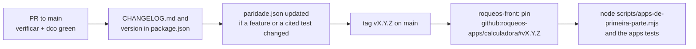

# Operations

_English | [Português](pt-BR/OPERACAO.md)_

> **Who it is for:** the maintainer who keeps the repository healthy, releases a version and brings it into RoqueOS.
> **What is here:** the maintenance routine, releasing a version, updating the SDK without breaking, undoing, backup, and what to watch.
> **Where to go for the rest:** when a step fails, [WHEN-IT-BREAKS.md](WHEN-IT-BREAKS.md); the commands one by one, [REFERENCE.md](REFERENCE.md); the contract RoqueOS checks, [INTEGRATIONS.md](INTEGRATIONS.md).

## Contents

1. [The routine](#1-the-routine)
2. [Releasing a version](#2-releasing-a-version)
3. [Updating without breaking](#3-updating-without-breaking)
4. [Undoing](#4-undoing)
5. [Backup and restore](#5-backup-and-restore)
6. [Monitoring](#6-monitoring)

## 1. The routine

Nothing runs on a schedule here: there is no server, job or cron. The routine is the maintenance
loop in [.claude/loop.md](../.claude/loop.md), one item per iteration, stopping at the first one
that has work:

| Order | Check                                    | How                                                                                                                |
| ----- | ---------------------------------------- | ------------------------------------------------------------------------------------------------------------------ |
| 1     | the local gate is red                    | `yarn verificar` (or `roqueos-gate`)                                                                               |
| 2     | GitHub CI is red                         | `gh run list --limit 3`; red there and green here is a diverging environment, investigated first                   |
| 3     | a PR without `Signed-off-by`             | the `dco` workflow fails; the contributor gets the command that fixes it, `git rebase --signoff main`              |
| 4     | an outside issue or PR without an answer | `gh issue list`, `gh pr list`                                                                                      |
| 5     | an asset without origin                  | a new file in `public/` needs its line in [ASSETS.md](../ASSETS.md)                                                |
| 6     | the SDK is behind                        | a new `app-sdk` tag with a capability the app uses becomes a bump (section 3)                                      |
| 7     | documentation drift                      | README, CONTRIBUTING, `app.json` and these documents say the same thing about features, capabilities and languages |

A visible change is not done until the app was opened for real in `yarn dev`, with a screenshot,
and in RoqueOS when the change gets there ([.claude/loop.md](../.claude/loop.md)).

## 2. Releasing a version

RoqueOS does not follow `main`: it pins a tag. A change reaches people only after a tag and a
RoqueOS commit that pins it.



In this repository:

```bash
yarn verificar                       # green, on the main that will be tagged
git switch main && git pull
git tag v0.2.1                       # the new version, the same as package.json
git push origin v0.2.1
```

The repository has no release script; the commands above are plain git, and the tag that exists
today is `v0.2.0`. `CHANGELOG.md` follows Keep a Changelog, and `package.json` carries the same
version.

In `roqueos-front` (the steps written in the ecosystem graph, `roqueos-ecosystem`,
`plugins/roqueos-kit/graph/ecosystem.json`, edge `calculadora` to `contract:app-sdk`): pin
`"@roqueos-apps/calculadora": "github:roqueos-apps/calculadora#vX.Y.Z"` in its `package.json`, pass
the `supply-chain-reviewer`, regenerate the registry with `node scripts/apps-de-primeira-parte.mjs`
and run its tests; `tests/unit/architecture/apps-fora-do-nucleo.spec.js` checks the `paridade.json`
of the installed package. Before tagging you can run the same parity check against this clone:

```bash
cd ../roqueos-front && node scripts/paridade-dos-apps.mjs ../calculadora
```

Measured on 18/11/2026: `paridade ok: 63 funcionalidades ({"mantida":41,"mudou":22,"perdida":0})`.

## 3. Updating without breaking

The SDK is pinned by tag in [package.json](../package.json) (`github:roqueos-apps/app-sdk#v0.1.0`).
To move to a new SDK tag: change the pin, `yarn install --ignore-scripts`, `yarn verificar`
green, a `CHANGELOG.md` entry saying what changed, then a new tag of the app (section 2). The order
across repositories is RoqueOS first (it consumes the new SDK), then the apps (the graph gives the
front order 1 and the apps order 2). Dev dependencies are pinned to exact versions; a bump goes
through the same `yarn verificar`.

Never change the `id` in [app.json](../app.json): RoqueOS finds windows, shortcuts and preferences
of people who already use it by that id, and `test/app.spec.js` fails if it changes.

## 4. Undoing

| Step                                    | How to go back                                                                                                                                                                                                      |
| --------------------------------------- | ------------------------------------------------------------------------------------------------------------------------------------------------------------------------------------------------------------------- |
| a merged PR                             | `git revert <commit> -s` in a new PR; never a force push on `main`                                                                                                                                                  |
| a tag that RoqueOS already pinned       | pin the previous tag again in `roqueos-front` and regenerate the registry; then fix forward with a new tag. No rule is written here about moving or deleting a published tag, so this document does not tell you to |
| a tag that nobody pinned yet            | `git push origin :refs/tags/vX.Y.Z` and `git tag -d vX.Y.Z` (not proven here: no such case is recorded)                                                                                                             |
| a `paridade.json` that fails in RoqueOS | the RoqueOS pin does not move until the inventory passes; fix it here, new tag                                                                                                                                      |

## 5. Backup and restore

The app keeps no data, so there is nothing of the people who use it to back up: history and
memory live only in the open window. The repository is the source, on GitHub
(`roqueos-apps/calculadora`), and every published version is a tag. Restoring a machine is a
`git clone` and `yarn install --ignore-scripts` ([GETTING-STARTED.md](GETTING-STARTED.md)). The
pre-push hook lives in `.git/hooks/`, which is not versioned; it comes back with
`node scripts/install-git-hooks.mjs` in `roqueos-ecosystem`.

## 6. Monitoring

| What               | Where                                                                  | Healthy is                                                                   |
| ------------------ | ---------------------------------------------------------------------- | ---------------------------------------------------------------------------- |
| the gate           | `yarn verificar`                                                       | ends with `ok, o repo cumpre o contrato.`; 75 tests in 8 files on 18/11/2026 |
| CI                 | `gh run list --limit 3`                                                | `verificar` and `dco` green on the last runs                                 |
| parity             | `node scripts/paridade-dos-apps.mjs ../calculadora` in `roqueos-front` | `paridade ok`, with `perdida` at 0                                           |
| the pin in RoqueOS | `@roqueos-apps/calculadora` in `roqueos-front/package.json`            | the latest tag of this repository (`v0.2.0` on 18/11/2026)                   |
| the family doctor  | `roqueos-doctor`                                                       | no item red that this repository can fix                                     |
