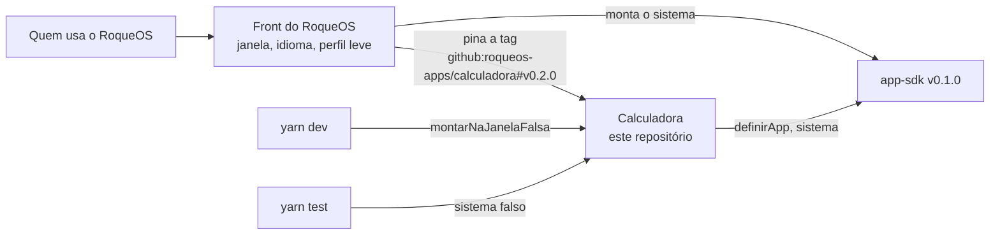
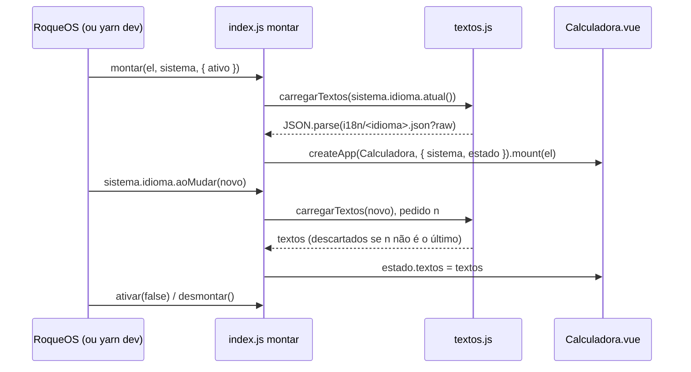
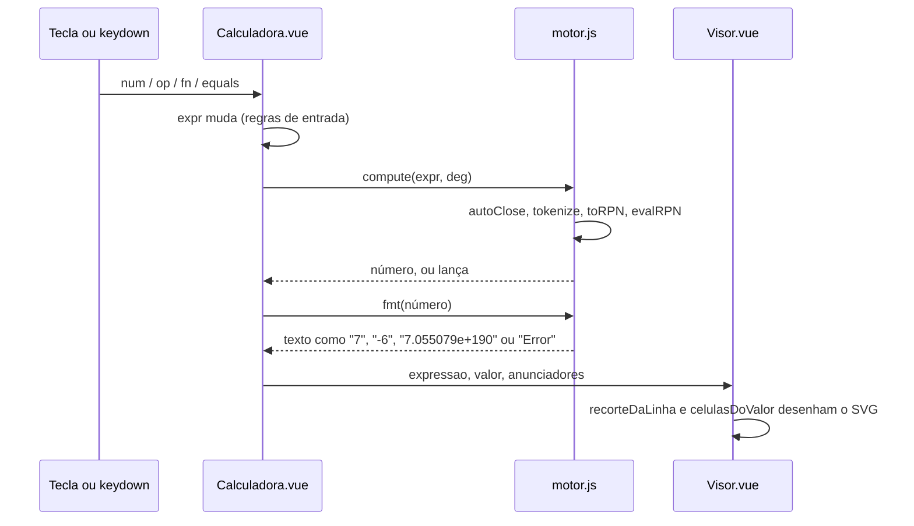

# Arquitetura

_[English](../ARCHITECTURE.md) | Português_

> **Para quem:** quem vai mudar a calculadora, ou revisar uma mudança nela.
> **O que tem aqui:** a ideia, o contexto, onde roda, os componentes e os arquivos deles, os dois fluxos principais, os dados que atravessam fronteira, segurança, as decisões de design e os limites conhecidos.
> **Onde ir para o resto:** comandos e formatos campo a campo na [REFERENCIA.md](REFERENCIA.md); o contrato com o RoqueOS em [INTEGRACOES.md](INTEGRACOES.md); as decisões de produto em [DECISOES.md](DECISOES.md).

## Sumário

1. [A ideia em um parágrafo](#1-a-ideia-em-um-parágrafo)
2. [Contexto: quem usa e do que depende](#2-contexto-quem-usa-e-do-que-depende)
3. [Processos e onde rodam](#3-processos-e-onde-rodam)
4. [Componentes](#4-componentes)
5. [Os fluxos principais](#5-os-fluxos-principais)
6. [Dados e contratos](#6-dados-e-contratos)
7. [Segurança e segredos](#7-segurança-e-segredos)
8. [Decisões de design](#8-decisões-de-design)
9. [Limites conhecidos](#9-limites-conhecidos)
10. [Como os diagramas são feitos](#10-como-os-diagramas-são-feitos)

## 1. A ideia em um parágrafo

A Calculadora é um app do RoqueOS que mora fora do RoqueOS. Ela exporta um objeto feito com o
`definirApp` do `@roqueos-apps/app-sdk` ([src/index.js](../../src/index.js)); o RoqueOS chama o
`montar` dele com um elemento, o `sistema` e se a janela está ativa, e o app cria o próprio app
Vue dentro do elemento. Tudo o que ela precisa do sistema (idioma, perfil leve, janela ativa) vem
pelo `sistema`; ela não importa nada do RoqueOS. A conta é um módulo puro
([src/motor.js](../../src/motor.js)) e o visor é SVG desenhado de geometria pura
([src/visor/](../../src/visor/matriz.js)), então a maior parte do comportamento é testada sem
tela.

## 2. Contexto: quem usa e do que depende

| Dependência                                                                 | Para que serve                                                                         | O que acontece quando falta                                               |
| --------------------------------------------------------------------------- | -------------------------------------------------------------------------------------- | ------------------------------------------------------------------------- |
| [`@roqueos-apps/app-sdk`](https://github.com/roqueos-apps/app-sdk) `v0.1.0` | `definirApp`, a janela de desenvolvimento, o sistema falso dos testes, o comando `app` | sem install (vem do GitHub pela tag), sem `yarn dev`, sem `app check`     |
| `vue` `^3.5.0` (peer)                                                       | o app Vue próprio                                                                      | o RoqueOS fornece; neste repo é dependência de desenvolvimento (`3.5.29`) |
| Front do RoqueOS                                                            | hospeda a janela e monta o `sistema` de verdade                                        | o app continua funcionando sozinho no `yarn dev`                          |
| rede, servidor, banco                                                       | nenhum                                                                                 | nada: o app nunca chama para fora                                         |

## 3. Processos e onde rodam

| Onde                            | Como sobe                                                                                                                             | Quem chama                                        |
| ------------------------------- | ------------------------------------------------------------------------------------------------------------------------------------- | ------------------------------------------------- |
| Dentro do RoqueOS, no navegador | o RoqueOS abre a janela de id `calculator` e chama o `montar`                                                                         | quem usa, pela dock, pela Launchpad ou pela busca |
| Sozinha, no navegador           | `yarn dev` (Vite, [vite.config.js](../../vite.config.js)) serve o [index.html](../../index.html) e o [dev/main.js](../../dev/main.js) | quem desenvolve                                   |
| No Node, com jsdom              | `yarn test` (Vitest, preparo em [test/preparar.js](../../test/preparar.js))                                                           | quem desenvolve, o gancho de pre-push e o CI      |
| GitHub Actions                  | [ci.yml](../../.github/workflows/ci.yml) em push na `main` e em todo PR; [dco.yml](../../.github/workflows/dco.yml) em todo PR        | o GitHub                                          |

Dentro do RoqueOS quem compila o app é o Vite do RoqueOS, e não o
[vite.config.js](../../vite.config.js) deste repositório; esse arquivo só serve o `yarn dev` e o
`yarn test`.

## 4. Componentes

| Arquivo                                                                                    | Responsabilidade                                                                                                                        | Quem depende dele                                           |
| ------------------------------------------------------------------------------------------ | --------------------------------------------------------------------------------------------------------------------------------------- | ----------------------------------------------------------- |
| [app.json](../../app.json)                                                                 | o manifesto: `id` permanente, nomes, descrições, ícone, cor, categoria, janela, capacidades                                             | o RoqueOS (registro gerado), o `app check`, o `dev/main.js` |
| [src/index.js](../../src/index.js)                                                         | `definirApp`: monta o app Vue depois que o texto chega, guarda o `estado` (`ativo`, `idioma`, `textos`), devolve `ativar` e `desmontar` | o RoqueOS, o `dev/main.js`, o `test/app.spec.js`            |
| [src/Calculadora.vue](../../src/Calculadora.vue)                                           | a carcaça, o teclado (`TECLADO`), as regras de entrada, memória, histórico, teclado físico                                              | `index.js`                                                  |
| [src/Visor.vue](../../src/Visor.vue)                                                       | o visor de duas linhas: indicadores, matriz de pontos, sete segmentos, texto de verdade escondido                                       | `Calculadora.vue`                                           |
| [src/visor/matriz.js](../../src/visor/matriz.js)                                           | a fonte 5 × 7 desenhada aqui, a linha de 16 caracteres e o recorte dela (`recorteDaLinha`)                                              | `Visor.vue`                                                 |
| [src/visor/segmentos.js](../../src/visor/segmentos.js)                                     | os segmentos de cada caractere, 13 células mais um expoente de 3 dígitos (`celulasDoValor`)                                             | `Visor.vue`                                                 |
| [src/motor.js](../../src/motor.js)                                                         | `tokenize`, `toRPN`, `evalRPN`, `autoClose`, `compute`, `fmt`                                                                           | `Calculadora.vue`                                           |
| [src/textos.js](../../src/textos.js)                                                       | o mapa estático dos dez `i18n/*.json`, carregados com `?raw`; `traduzir`                                                                | `index.js`, `Calculadora.vue`                               |
| [src/useInclinacao.js](../../src/useInclinacao.js)                                         | o reflexo que segue o sensor ou o ponteiro                                                                                              | `Calculadora.vue`                                           |
| [src/calculadora.scss](../../src/calculadora.scss), [src/visor.scss](../../src/visor.scss) | a carcaça e as teclas em `cqw` da carcaça, o cristal líquido; as cores em `--calc-*`                                                    | os dois componentes                                         |

## 5. Os fluxos principais

**Montar e trocar de idioma.** O `montar` pede o texto do idioma atual e só cria o app Vue quando
ele chega, para o histórico nunca aparecer sem rótulo. Cada pedido de idioma ganha um número; a
resposta que não é a do último pedido é descartada, então duas trocas seguidas terminam no último
idioma pedido ([src/index.js](../../src/index.js),
[test/troca-de-idioma.spec.js](../../test/troca-de-idioma.spec.js)).

**Da tecla apertada ao visor.** Uma tecla da tela ou do teclado físico (só com `estado.ativo`)
muda o texto da conta. Enquanto se digita, um observador recalcula a prévia; a conta que ainda não
fecha deixa a última prévia que fechou. O `=` avalia, grava a entrada do histórico (a mais nova
primeiro, até 60) e passa para o modo de resultado
([src/Calculadora.vue](../../src/Calculadora.vue)).

## 6. Dados e contratos

Três arquivos atravessam fronteira; os campos estão na
[REFERENCIA.md](REFERENCIA.md#formatos) e o contrato em [INTEGRACOES.md](INTEGRACOES.md).

| Arquivo                                                          | Quem escreve     | Quem lê                                                                                             |
| ---------------------------------------------------------------- | ---------------- | --------------------------------------------------------------------------------------------------- |
| [app.json](../../app.json)                                       | este repositório | o RoqueOS (`scripts/apps-de-primeira-parte.mjs` do `roqueos-front`), o `app check`, o `dev/main.js` |
| [i18n/](../../i18n/pt-BR.json) (dez arquivos, cinco chaves cada) | este repositório | `textos.js`, `app check`                                                                            |
| [paridade.json](../../paridade.json)                             | este repositório | o RoqueOS (`scripts/paridade-dos-apps.mjs`, `apps-fora-do-nucleo.spec.js`)                          |

O texto que o motor escreve também é contrato entre o `motor.js` e o visor: o `fmt` devolve
`"0"`, até doze algarismos significativos, notação científica fora de `1e-9 <= |n| < 1e12`, ou
`"Error"`, e o visor foi dimensionado para o mais comprido deles (13 células).

## 7. Segurança e segredos

Não há segredo: nem chave, nem token, nem `.env`, nem conta. O app não grava nada, não chama
servidor nem banco, e não declara capacidade (`"capacidades": []` no [app.json](../../app.json)).
Ele roda na mesma origem do RoqueOS, o que não é fronteira de segurança; o que protege quem usa
está no [SECURITY.md](../../SECURITY.md): revisão do mantenedor pelo
[CODEOWNERS](../../.github/CODEOWNERS), commits com `Signed-off-by`, tag exata pinada no RoqueOS,
nenhum script de install, e CI que não lê segredo e só tem `contents: read`.

## 8. Decisões de design

| Decidido                                                                                 | Alternativa recusada                       | Por quê                                                                                                                                                                                                                | Quando                                                       |
| ---------------------------------------------------------------------------------------- | ------------------------------------------ | ---------------------------------------------------------------------------------------------------------------------------------------------------------------------------------------------------------------------- | ------------------------------------------------------------ |
| O app cria o próprio app Vue dentro do elemento                                          | um componente dentro do app Vue do RoqueOS | o mesmo código roda no RoqueOS, no `yarn dev` e no teste; nenhuma store, plugin ou estilo global do RoqueOS entra ([src/index.js](../../src/index.js))                                                                 | 27/09/2026 (0.1.0)                                           |
| O texto carrega com `?raw` e `JSON.parse`, de um mapa estático                           | `import` de JSON; `import(variável)`       | o build do RoqueOS quebra com import de JSON direto fora do `src/i18n/` dele (medido nos jogos em 25/09/2026); o import por variável faz o Vite empacotar os dez idiomas juntos ([src/textos.js](../../src/textos.js)) | 27/09/2026                                                   |
| O motor é um módulo puro, com graus passados como argumento                              | a conta dentro do componente               | é testado sem montar a tela ([test/motor.spec.js](../../test/motor.spec.js))                                                                                                                                           | 27/09/2026                                                   |
| O `tokenize` lê o hífen e o `e+` que o `fmt` escreve                                     | deixar ilegível                            | seguir a partir de `-6` perdia o sinal e seguir a partir de notação científica dava Error (corrigido em 28/09/2026)                                                                                                    | 28/09/2026 (0.2.0)                                           |
| O visor é SVG, com fonte e segmentos desenhados aqui, fixo em 16 caracteres e 13 células | arquivo de fonte; visor que encolhe        | nenhum asset para licenciar, e nada encolhe nem corta: 13 células é a saída mais comprida do `fmt`                                                                                                                     | 28/09/2026 (0.2.0)                                           |
| Teclado e visor sempre `dir="ltr"`                                                       | seguir a direção do idioma                 | espelhar poria o 7 à direita do 9 e o "M−" viraria "−M"                                                                                                                                                                | já dentro do RoqueOS, mantido (`mantida` no `paridade.json`) |
| Perfil leve pelo `sistema.desempenho.modoLeve()`                                         | o atributo `data-low-end` do RoqueOS       | aquele atributo é detalhe do RoqueOS que ninguém trava ([src/useInclinacao.js](../../src/useInclinacao.js))                                                                                                            | 28/09/2026 (0.2.0)                                           |
| As cores são `--calc-*` e nenhuma vem do tema do RoqueOS                                 | seguir o tema                              | a calculadora é um objeto e fica igual no claro e no escuro; o prefixo `--ros-` é do sistema                                                                                                                           | 28/09/2026 (0.2.0)                                           |
| Medidas em `cqw` da carcaça                                                              | pixels                                     | a calculadora inteira escala como um objeto e cabe na janela mínima de 300 × 540                                                                                                                                       | 28/09/2026 (0.2.0)                                           |

As decisões de produto (o `id` permanente, a cara dos anos 2000, o que o app não faz) estão em
[DECISOES.md](DECISOES.md).

## 9. Limites conhecidos

- Nada foi medido num iPhone nem num Android de verdade (a auditoria do `paridade.json` diz isso);
  a inclinação está coberta por teste com sensor simulado ([test/useInclinacao.spec.js](../../test/useInclinacao.spec.js)).
- Histórico e memória se perdem quando a janela fecha; nada persiste.
- Sem copiar e colar: a raiz tem `user-select: none` e não há atalho de área de transferência.
- Os números são doubles do JavaScript: o `fmt` mostra doze algarismos significativos, e `n!`
  acima de 170 é `Infinity`, que o motor devolve como `Error`.
- A conta com mais de 16 caracteres mostra o fim na linha de cima, com o ◀ aceso; o começo não
  aparece no visor (o texto escondido guarda a conta inteira).
- O `CLAUDE.md` diz que o app pode usar seis variáveis CSS do RoqueOS do contrato do SDK; o código
  não usa nenhuma (nenhum `var(--ros-` em `src/`, conferido em 18/11/2026).
- O RoqueOS compila o app com o Vite dele; problema de build lá não aparece no `yarn verificar`
  deste repositório.

## 10. Como os diagramas são feitos

Mermaid dentro deste arquivo, renderizado pelo GitHub. O original em inglês tem os mesmos
diagramas, com os rótulos em inglês. A imagem de capa [capa.jpg](../capa.jpg) é um print,
documentado no [ASSETS.md](../../ASSETS.md).
