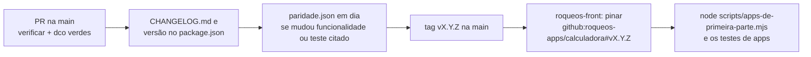

# Operação

_[English](../OPERATIONS.md) | Português_

> **Para quem:** o mantenedor que deixa o repositório saudável, solta uma versão e leva ela para dentro do RoqueOS.
> **O que tem aqui:** a rotina de manutenção, soltar uma versão, atualizar o SDK sem quebrar, desfazer, backup e o que monitorar.
> **Onde ir para o resto:** quando um passo falha, [QUANDO-QUEBRA.md](QUANDO-QUEBRA.md); os comandos um a um, [REFERENCIA.md](REFERENCIA.md); o contrato que o RoqueOS confere, [INTEGRACOES.md](INTEGRACOES.md).

## Sumário

1. [A rotina](#1-a-rotina)
2. [Soltar uma versão](#2-soltar-uma-versão)
3. [Atualizar sem quebrar](#3-atualizar-sem-quebrar)
4. [Desfazer](#4-desfazer)
5. [Backup e restauração](#5-backup-e-restauração)
6. [Monitorar](#6-monitorar)

## 1. A rotina

Nada roda com horário aqui: não há servidor, job nem cron. A rotina é o loop de manutenção do
[.claude/loop.md](../../.claude/loop.md), uma coisa por iteração, parando na primeira que tiver
trabalho:

| Ordem | Confere                          | Como                                                                                                                 |
| ----- | -------------------------------- | -------------------------------------------------------------------------------------------------------------------- |
| 1     | o gate local está vermelho       | `yarn verificar` (ou `roqueos-gate`)                                                                                 |
| 2     | o CI do GitHub está vermelho     | `gh run list --limit 3`; vermelho lá e verde aqui é ambiente divergente, e se investiga primeiro                     |
| 3     | PR sem `Signed-off-by`           | o workflow `dco` reprova; quem contribui recebe o comando que conserta, `git rebase --signoff main`                  |
| 4     | issue ou PR de fora sem resposta | `gh issue list`, `gh pr list`                                                                                        |
| 5     | asset sem origem                 | arquivo novo em `public/` precisa da linha dele no [ASSETS.md](../../ASSETS.md)                                      |
| 6     | o SDK está atrás                 | tag nova do `app-sdk` com capacidade que o app usa vira bump (seção 3)                                               |
| 7     | deriva de documentação           | README, CONTRIBUTING, `app.json` e estes documentos dizem a mesma coisa sobre funcionalidades, capacidades e idiomas |

Mudança visível não fecha sem o app aberto de verdade no `yarn dev`, com print, e no RoqueOS
quando a mudança chega lá ([.claude/loop.md](../../.claude/loop.md)).

## 2. Soltar uma versão

O RoqueOS não segue a `main`: ele pina uma tag. A mudança só chega em quem usa depois de uma tag e
de um commit do RoqueOS que a pina.



Neste repositório:

```bash
yarn verificar                       # verde, na main que vai ganhar a tag
git switch main && git pull
git tag v0.2.1                       # a versão nova, a mesma do package.json
git push origin v0.2.1
```

O repositório não tem script de release; os comandos acima são git puro, e a tag que existe hoje
é a `v0.2.0`. O `CHANGELOG.md` segue o Keep a Changelog, e o `package.json` leva a mesma versão.

No `roqueos-front` (os passos escritos no grafo do ecossistema, `roqueos-ecosystem`,
`plugins/roqueos-kit/graph/ecosystem.json`, aresta `calculadora` para `contract:app-sdk`): pinar
`"@roqueos-apps/calculadora": "github:roqueos-apps/calculadora#vX.Y.Z"` no `package.json` dele,
passar o `supply-chain-reviewer`, regenerar o registro com
`node scripts/apps-de-primeira-parte.mjs` e rodar os testes dele; o
`tests/unit/architecture/apps-fora-do-nucleo.spec.js` confere o `paridade.json` do pacote
instalado. Antes da tag dá para rodar a mesma conferência de paridade contra este clone:

```bash
cd ../roqueos-front && node scripts/paridade-dos-apps.mjs ../calculadora
```

Medido em 18/11/2026: `paridade ok: 63 funcionalidades ({"mantida":41,"mudou":22,"perdida":0})`.

## 3. Atualizar sem quebrar

O SDK está pinado por tag no [package.json](../../package.json)
(`github:roqueos-apps/app-sdk#v0.1.0`). Para passar a uma tag nova do SDK: mude o pino,
`yarn install --ignore-scripts`, `yarn verificar` verde, uma entrada no `CHANGELOG.md` dizendo o
que mudou, e então uma tag nova do app (seção 2). A ordem entre repositórios é o RoqueOS primeiro
(ele consome o SDK novo), depois os apps (o grafo dá ordem 1 ao front e ordem 2 aos apps). As
dependências de desenvolvimento estão pinadas em versão exata; um bump passa pelo mesmo
`yarn verificar`.

Nunca mude o `id` do [app.json](../../app.json): é por ele que o RoqueOS acha janelas, atalhos e
preferências de quem já usa, e o `test/app.spec.js` reprova se ele mudar.

## 4. Desfazer

| Passo                                     | Como voltar                                                                                                                                                                                                                   |
| ----------------------------------------- | ----------------------------------------------------------------------------------------------------------------------------------------------------------------------------------------------------------------------------- |
| um PR que entrou                          | `git revert <commit> -s` num PR novo; nunca force push na `main`                                                                                                                                                              |
| uma tag que o RoqueOS já pinou            | pinar de novo a tag anterior no `roqueos-front` e regenerar o registro; depois consertar para a frente com tag nova. Não há regra escrita aqui sobre mover ou apagar tag publicada, então este documento não manda fazer isso |
| uma tag que ninguém pinou ainda           | `git push origin :refs/tags/vX.Y.Z` e `git tag -d vX.Y.Z` (não provado aqui: nenhum caso assim está registrado)                                                                                                               |
| um `paridade.json` que reprova no RoqueOS | o pino do RoqueOS não anda até o inventário passar; conserte aqui, tag nova                                                                                                                                                   |

## 5. Backup e restauração

O app não guarda dado, então não há nada de quem usa para guardar: histórico e memória só vivem
na janela aberta. O repositório é a fonte, no GitHub (`roqueos-apps/calculadora`), e toda versão
publicada é uma tag. Restaurar uma máquina é `git clone` e `yarn install --ignore-scripts`
([COMECAR.md](COMECAR.md)). O gancho de pre-push mora em `.git/hooks/`, que não é versionado; ele
volta com `node scripts/install-git-hooks.mjs` no `roqueos-ecosystem`.

## 6. Monitorar

| O quê               | Onde                                                                   | Saudável é                                                                         |
| ------------------- | ---------------------------------------------------------------------- | ---------------------------------------------------------------------------------- |
| o gate              | `yarn verificar`                                                       | termina com `ok, o repo cumpre o contrato.`; 75 testes em 8 arquivos em 18/11/2026 |
| o CI                | `gh run list --limit 3`                                                | `verificar` e `dco` verdes nas últimas execuções                                   |
| a paridade          | `node scripts/paridade-dos-apps.mjs ../calculadora` no `roqueos-front` | `paridade ok`, com `perdida` em 0                                                  |
| o pino no RoqueOS   | `@roqueos-apps/calculadora` no `roqueos-front/package.json`            | a tag mais nova deste repositório (`v0.2.0` em 18/11/2026)                         |
| o doctor da família | `roqueos-doctor`                                                       | nenhum item vermelho que este repositório possa consertar                          |
